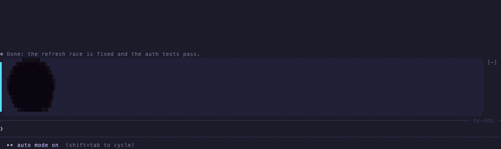
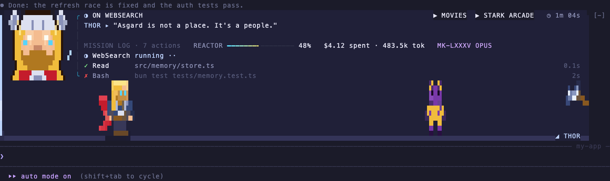
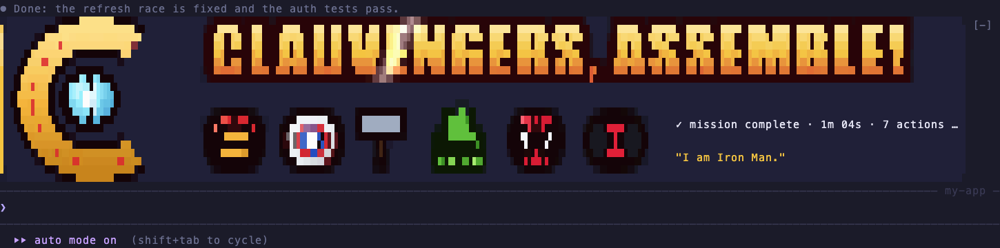
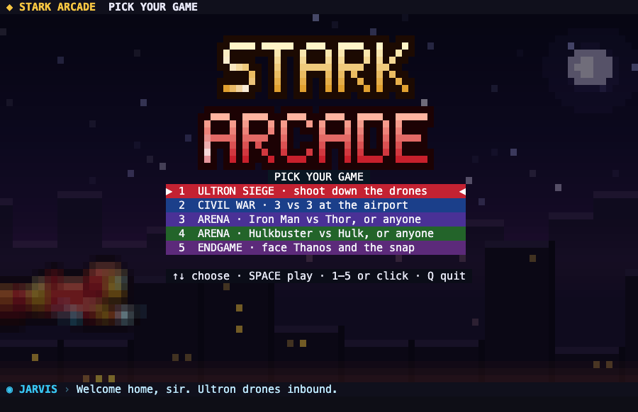
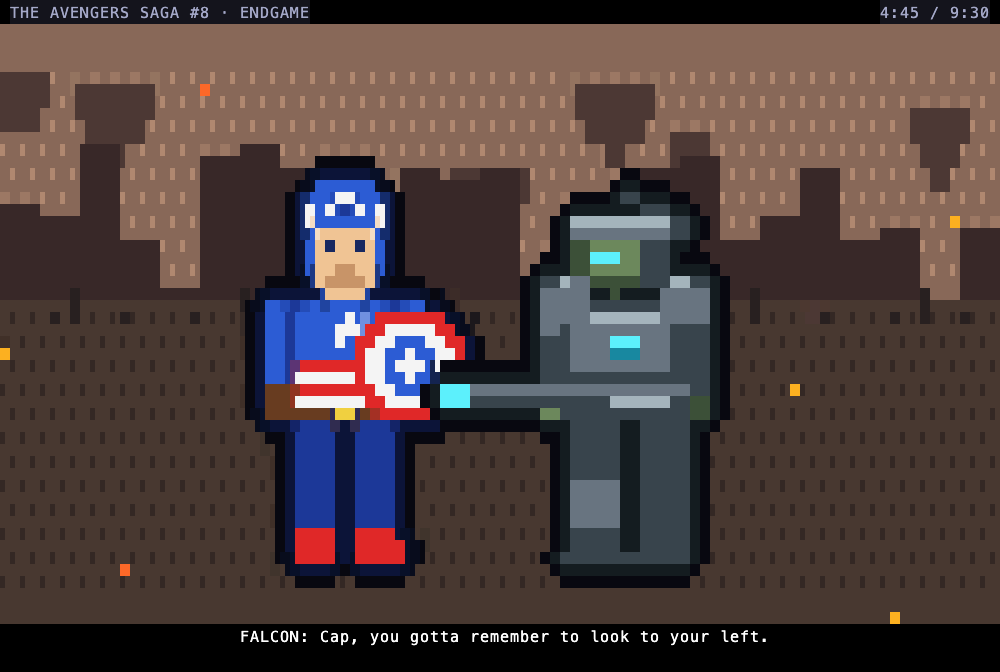
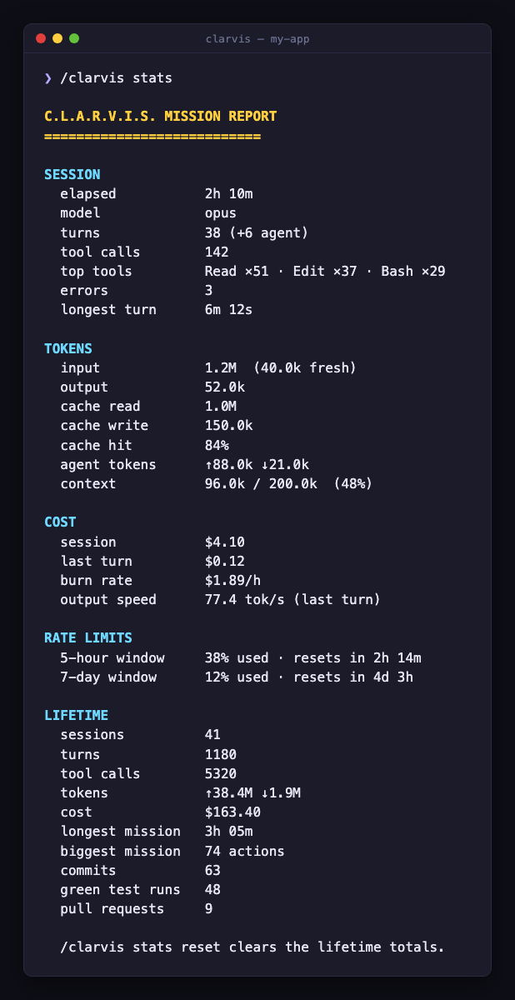
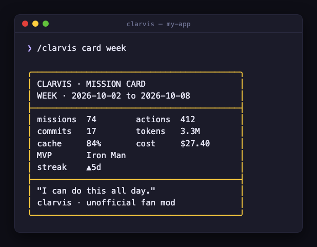

<h1 align="center">Clarvis: an Avengers fan mod for Claude Code</h1>

<p align="center">
  <b>A free Claude Code plugin that turns your terminal into Tony Stark's HUD.</b><br>
  Heroes animate above your prompt while Claude works, a live HUD tracks your tokens and cost,<br>
  and when the job's done the team assembles. Plus a pixel arcade and a comic theater, right in your terminal.
</p>

<p align="center">
  <a href="https://github.com/shahsanket2107/clarvis/actions/workflows/ci.yml"></a>
  <a href="LICENSE"></a>
  
  
  
  <a href="https://github.com/shahsanket2107/clarvis/stargazers"></a>
</p>

<p align="center">
  
</p>

```
/plugin install clarvis --marketplace shahsanket2107/clarvis
```

Paste that at the Claude Code prompt, press `y`, then Enter. That's it. Try `/clarvis demo` for the 45-second showreel.

> **Unofficial fan project.** Not made, licensed or endorsed by Marvel, Disney or Anthropic. All art is original pixel art
> drawn for this project, and it's free forever. See [NOTICE.md](NOTICE.md).

---

## What it does

**Clarvis** (Claude + J.A.R.V.I.S.) is a Claude Code plugin, a *mod*, that turns the space above your prompt into Tony Stark's
heads-up display: a statusline-style HUD for token usage and cost, plus heroes, games and comics while Claude works.

- **A hero for every moment.** While Claude works, a rotating cast of 30 characters takes a 3D stage: Iron Man, Thor, Hulk,
  Spider-Man, Loki, the Guardians and more, a new one every 8 seconds. Each roasts what Claude is *actually* doing.
- **CLAUVENGERS, ASSEMBLE!** Finish a task and the team assembles with your time, actions and cost. Commit, and it says
  *"Commit a1b2c3d is in the books."* Turn your tests green: *"Tests: 142 passed. Bugs, dusted."*
- **Something breaks? Thanos shows up.** If Claude's last command fails, he snaps. When Claude asks you a question,
  Nick Fury holds the screen until you answer.
- **Live usage HUD.** Context gauge, tokens in and out, cache hit rate, cost so far, and your 5-hour limit, always on
  screen. `/clarvis stats` gives the full C.L.A.R.V.I.S. mission report.
- **Stark Arcade.** Five pixel games in a pane: an Ultron drone siege, a 3-vs-3 Civil War tag fight, two free-pick arenas
  with 16 fighters, and an Endgame boss fight.
- **Avengers Theater.** Ten short comic-panel episodes with speech balloons and sound effects, reshuffled every viewing.
- **Trophies, streaks and seasons.** 27 trophies to collect, a daily streak, villains taking over for Halloween week,
  snow in December, and a few rare easter eggs.
- **Chiptune sounds**, generated in code (on macOS). `/clarvis sound off` mutes them.

<table>
  <tr>
    <td width="50%"></td>
    <td width="50%"></td>
  </tr>
  <tr>
    <td></td>
    <td></td>
  </tr>
  <tr>
    <td></td>
    <td></td>
  </tr>
</table>

## Show off your setup

Run `/clarvis card week` and paste the card into a post. It's copied to your clipboard already. Tag it
**#Clarvis** and **#ClaudeCode**: I'd love to see which hero is carrying your codebase.

If Clarvis made Claude Code a little more fun, **[give it a ⭐](https://github.com/shahsanket2107/clarvis)**. It's the
best way to help other Claude Code users find it.

## Install

**Needs:** Claude Code **2.1.287 or later** (`claude --version`) in a terminal or the Desktop app's Code tab.

1. Open Claude Code and paste:
   ```
   /plugin install clarvis --marketplace shahsanket2107/clarvis
   ```
2. Press `y` to add the marketplace, then Enter to install for your user. The band appears straight away.
3. Type `/clarvis` for the briefing, or `/clarvis demo` to see everything.

**From your shell instead:**
```bash
claude plugin marketplace add shahsanket2107/clarvis
claude plugin install clarvis@clarvis
```
then run `/reload-plugins` in any open session.

**Best look:** a truecolor terminal such as Ghostty, iTerm2, WezTerm or kitty. On terminals that can't show the art
(macOS Terminal.app, or tmux without `CLAUDE_CODE_TMUX_TRUECOLOR=1`), Clarvis switches to a tidy text-only **lite** mode
by itself. **For the arcade and theater**, Claude Code must be in fullscreen mode (`/tui fullscreen`), which passes
clicks and keys to panes.

**Update:** `/plugin`, then the **Installed** tab, then update. **Uninstall:** same place, uninstall `clarvis`.

## Commands

| Command | What it does |
|---|---|
| `/clarvis` | The briefing: every command and your current settings |
| `/clarvis demo` | A 45-second showreel with sample numbers (nothing is counted) |
| `/clarvis full` · `calm` · `lite` · `off` | Full art · same content, no motion · text only · stock Claude Code |
| `/clarvis stats [reset]` | The mission report: tokens, cache, cost, burn rate, limits, lifetime totals |
| `/clarvis card [today\|week\|all] [nocost]` | A shareable mission card, copied to your clipboard |
| `/clarvis trophies` | Your trophy case |
| `/clarvis pick <hero\|auto> [here]` | Put one hero on stage (`here` pins it to this project) |
| `/clarvis team <avengers\|guardians\|wakanda\|cosmic\|all>` | Choose who takes the stage |
| `/clarvis play` | Stark Arcade (needs fullscreen) |
| `/clarvis movies` · `movie <1-9, 0 for 10\|name\|next\|random>` | Avengers Theater (needs fullscreen) |
| `/clarvis sound on\|off` | Chiptune sounds (on by default, plays on macOS) |
| `/clarvis notify <minutes\|off>` | A desktop ping when a task runs longer than that |
| `/clarvis fx on\|off` | Tint the transcript with the theater's hit bursts (off by default) |

**Settings** (in `/plugin`, the plugin's options): Look, Show cost, Sound and Notify after minutes. To override the look
for one launch, set `CLARVIS=calm` (or `full`, `lite`, `off`) in the environment.

## Arcade controls

Pick a game with 1–5, the arrows and SPACE, or a click.
- **Siege:** arrows or the mouse fly, SPACE fires, 1/2/3 are specials.
- **Fights:** tap ←/→ to step and double-tap to run, ↑ jumps, tap ↓ to guard (on the hit, it parries). SPACE ×3 chains
  into C (special) and X (super, once the gold meter is full). → then SPACE up close throws.

P pauses, Q twice quits, and the siege high score is saved.

## Privacy and safety

Clarvis is a **mod**: code that runs inside Claude Code. Here's exactly what it does:

- **It only watches and draws.** It never changes a tool call, a prompt or a permission decision, and never answers
  a permission request for you.
- **Nothing leaves your machine.** No network requests, no analytics, no tracking. It starts no processes and reads
  or writes none of your files.
- **What it reads:** the session's model, usage and cost from Claude Code, the `CLARVIS` environment variable, and the
  output of Bash commands *only* to spot a commit hash, a test pass count or a PR number for the celebration. That
  output is never stored.
- **What it stores**, in Claude Code's per-plugin store: your settings, trophies, streak, lifetime totals, watched
  episodes and the arcade high score.
- **Idle cost: zero.** Frames repaint only while something moves. At rest it does nothing.

Check it yourself: `claude plugin validate .` on a clone lists every hook and every call the mod makes.

## FAQ

**Does it slow Claude down?** No. Drawing happens alongside Claude's work, never in front of it, and an idle band does
no work at all.

**Does it work in VS Code, `claude -p` or the cloud?** Claude Code only draws mods in the terminal and the Desktop
app's Code tab. Elsewhere Clarvis stays out of the way.

**It's too much while I'm focusing.** `/clarvis calm` keeps the information and drops the motion. `/clarvis off`
brings back the stock look.

**Why does the band show `~`?** You started Claude in your home folder. In a project it shows the project's name.

**What's a "cache hit"?** Claude re-reads your conversation on every reply, and repeated parts come from a cache at
about a tenth of the price. A higher cache % means cheaper, faster replies.

**Can I suggest a hero, game or episode?** Please do. Open an
[issue](https://github.com/shahsanket2107/clarvis/issues/new/choose).

## Develop

```bash
git clone https://github.com/shahsanket2107/clarvis && cd clarvis
claude --plugin-dir .          # run it from the folder; edits hot-reload
claude plugin validate .       # what the engine will load
claude plugin test .           # 500+ tests
bun scripts/demo.ts            # every view of the band in your terminal, no session needed
bun scripts/gallery.ts         # rebuild demo/gallery.html and open it in a browser
```

See [CONTRIBUTING.md](CONTRIBUTING.md). Art lives in `scripts/art.ts` (`bun scripts/bake.ts` re-bakes it), and the
README media is regenerated with `bun scripts/record.ts` (see `docs/media/README.md`).

## License

[MIT](LICENSE) for the code written for this project. Marvel characters, names and marks belong to their owners and
aren't covered by this license. Clarvis is an unofficial, non-commercial fan project. See [NOTICE.md](NOTICE.md).

Made by [Sanket Shah](https://github.com/shahsanket2107).
